  

 

我大概属于那种人：遇到一个小麻烦，第一反应不是「忍一下」，而是「那我写个工具吧」。

写 **Android**（Kotlin + Compose）、**Python** 脚本、**TypeScript** 工具，
也常年在 Windows 上给自己造桌面小玩意。
技术上有个藏不住的偏好 —— **液态玻璃**：为了那点折射和模糊的手感，可以把一个底栏返工十几遍。

 

### 🧊 现在在折腾

- **项目管家 Project Hub** —— 把「本地项目文件夹 ↔ GitHub 仓库」管起来：扫描导入、实时 Git 状态、一键跳转
- **液态玻璃** —— 在 Android Compose 和 Web 里复刻 iOS 26 那套折射效果，并整理成可复用的方案
- **AnonSchedule** —— 自己的课表 App，一路接进教务系统和学习通
- **AI Agent 工具链** —— MCP server、用量抓取、浏览器自动化
- **游戏日常自动化** —— 基于 MaaFramework 的那一套

 

### 📦 项目

**液态玻璃**

| 项目 | 一句话 | 栈 |
| :-- | :-- | :-- |
| [liquid-glass-bottom-bar](https://github.com/zy2755/liquid-glass-bottom-bar) | 底栏液态玻璃跨软件可复用方案：Compose 生产级实现 + Web 的 SVG 位移贴图折射，附参数速查与降级策略 | Kotlin |

**Android**

| 项目 | 一句话 | 栈 |
| :-- | :-- | :-- |
| [AnonSchedule](https://github.com/zy2755/AnonSchedule) | 课程表 App：周课表 / 教务导入 / 学习通 / 桌面小组件 / 液态玻璃 | Kotlin |
| [splitpatch](https://github.com/zy2755/splitpatch) | 把 LSPatch / NPatch 内嵌模式的 APK 拆回原包与模块（Windows GUI + 原生 Android） | Python |

**桌面小工具**

| 项目 | 一句话 | 栈 |
| :-- | :-- | :-- |
| [project-hub](https://github.com/zy2755/project-hub) | 项目管家：本地项目文件夹 ↔ GitHub 仓库的映射管理，扫描导入 / 实时 Git 状态 / 快捷筛选，纯标准库零依赖 | Python |
| [picline](https://github.com/zy2755/picline) | 图墙 · 截图，晾起来 —— 把每张截图挂到屏幕顶端的晾衣绳上 | JavaScript |
| [MuFileTools](https://github.com/zy2755/MuFileTools) | 文件转换器：PDF / Word / Excel → 图片或文件，外加图片转 ICO | Python |
| [display-dimmer-zh](https://github.com/zy2755/display-dimmer-zh) | Display Dimmer 的非官方简体中文汉化工具包（只放工具与词典，不含二进制） | C# |

**AI Agent & 自动化**

| 项目 | 一句话 | 栈 |
| :-- | :-- | :-- |
| [agent-browser-mcp](https://github.com/zy2755/agent-browser-mcp) | 给 AI agent 用的可靠浏览器控制 MCP server：ref 点击 + 断联自愈 | TypeScript |
| [wb-usage-fetchers](https://github.com/zy2755/wb-usage-fetchers) | AI 编码工具用量抓取 + 积分到期预警 | Python |
| [MaaBAHelper](https://github.com/zy2755/MaaBAHelper) | 蔚蓝档案国服日常自动化助手（MaaFramework PI V2） | Python |

 

### 🧰 常用的家伙

 

### 🍃 一点小事

- 相信**最好的工具是刚好解决自己问题的那一个** —— 所以仓库里全是我自己天天在用的东西
- 界面能多看一眼就多看一眼，动画掉一帧会难受
- 写东西的习惯：先让它在本地跑通，再搬上来
- 偏爱零依赖 —— 能靠标准库解决的，就不多装一个包
- 上游致敬：[Kyant0/AndroidLiquidGlass](https://github.com/Kyant0/AndroidLiquidGlass)，液态玻璃的很多启发来自他

 

  既然没人替你写那个工具，那就自己写。

